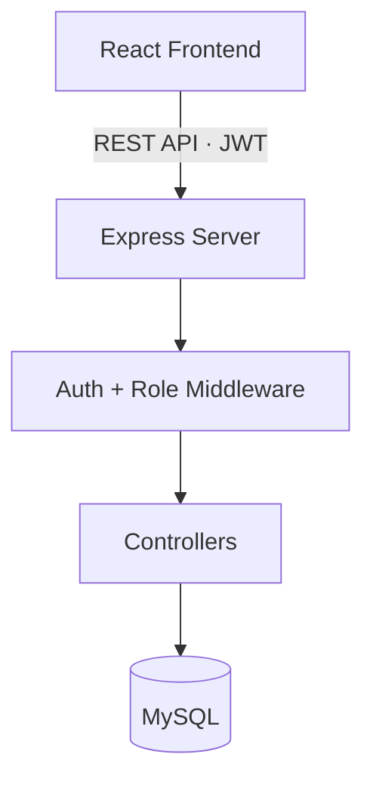

<h1 align="center">🚚 RouteX</h1>

<p align="center">
  <b>One platform to manage drivers, vehicles, shipments, assignments, tracking, and alerts.</b><br/>
  A full-stack fleet operations system with role-based access and synchronized operational states.
</p>

<p align="center">
  
  
  
  
  
  
  
</p>

<p align="center">
  <a href="YOUR_LIVE_DEMO_LINK">🌐 Live Demo</a> ·
  <a href="YOUR_VIDEO_LINK">🎥 Demo Video</a> ·
  <a href="#-architecture">🏗️ Architecture</a> ·
  <a href="#-assignment-lifecycle--state-sync">🔄 State Sync</a> ·
  <a href="#-installation--setup">🚀 Setup</a>
</p>

<!-- TODO: record a 10-15s GIF: login -> create assignment -> start -> complete -> statuses update -->


## 💡 The Problem

When driver details, vehicle availability, shipments, and alerts live in separate places,
dispatchers double-book vehicles, forget to free up drivers, and lose track of shipments.
RouteX centralizes these operations and **keeps driver, vehicle, and shipment states
automatically in sync** with each assignment.

## ⚡ What It Does

- 👨‍✈️ **Drivers**: add, search, filter, edit, and update status
- 🚛 **Vehicles**: manage registration, type, capacity, and operational status
- 📦 **Shipments**: full lifecycle from creation to delivery
- 📋 **Assignments**: link shipment + vehicle + driver, with validated status transitions
- 📍 **Tracking**: assignment/shipment tracking APIs with periodic live refresh
- 🚨 **Alerts**: severity, filtering, acknowledge and resolve workflow
- 📊 **Dashboard**: metrics driven by backend data, not hardcoded values
- 👥 **User management** with role-based access
- 🔐 **JWT authentication** with protected routes

---

## 🏗️ Architecture



```text
Frontend (React) → services/api.js → Express routes → middleware (auth, role)
→ controllers → MySQL
```

All frontend API calls go through one centralized layer (`src/services/api.js`), which
handles tokens, JSON requests/responses, and error handling.

---

## 🔄 Assignment Lifecycle & State Sync

The core engineering idea: **one assignment status change updates the related driver,
vehicle, and shipment**, so fleet state never drifts apart.

### Allowed transitions

```text
assigned → accepted → in_progress → completed

assigned    → cancelled
accepted    → cancelled
in_progress → cancelled

completed and cancelled are terminal states
```

Invalid transitions are rejected, which protects data integrity.

### State synchronization

| Event | Assignment | Shipment | Vehicle | Driver |
|---|---|---|---|---|
| **Created** | `assigned` | `assigned` | `in_transit` | `on_trip` |
| **Started** | `in_progress` | `in_transit` | `in_transit` | `on_trip` |
| **Completed** | `completed` | `delivered` | `available` | `available` |
| **Cancelled** | `cancelled` | `cancelled` | `available` | `available` |

### Status values

| Entity | Statuses |
|---|---|
| **Shipment** | `pending → assigned → in_transit → delivered` (also `delayed`, `cancelled`) |
| **Vehicle** | `available`, `in_transit`, `maintenance`, `inactive` |
| **Driver** | `available`, `on_trip`, `off_duty`, `inactive` |
| **User** | `active`, `inactive`, `suspended` |
| **Alert** | `open → acknowledged → resolved` |

---

## 🧩 Engineering Highlights

| Area | What I built | Why it matters |
|---|---|---|
| **State synchronization** | Assignment changes update driver, vehicle, and shipment states together | Prevents double-booking and stale availability |
| **Lifecycle validation** | Controlled assignment status transitions | Invalid state changes are rejected |
| **Authentication** | JWT + bcrypt, protected routes, expired/invalid token handling | Secure API access |
| **Role-based access** | `super_admin`, `fleet_manager`, `dispatcher`, `driver` | Each role sees only what it needs |
| **Data integrity** | Input validation, duplicate handling, protected user deletion, driver operational-state protection | Safer operations on live data |
| **Real data** | Dashboard metrics from backend/database | No fake hardcoded operational numbers |
| **Layered backend** | Routes → controllers → middleware → MySQL | Maintainable, modular code |
| **Centralized API layer** | One `api.js` for all frontend requests | No duplicated request logic |

---

## 👥 Roles

| Role | Access |
|---|---|
| 👑 **super_admin** | Full system access |
| 🏢 **fleet_manager** | Drivers, vehicles, shipments, assignments, reports, analytics |
| 📋 **dispatcher** | Shipments, assignments, tracking, alerts |
| 🚚 **driver** | Assigned trips, assignment status, tracking |

---

## 🛠️ Tech Stack

| Layer | Technologies |
|---|---|
| **Frontend** | React, JavaScript, React Router, Fetch API, CSS, responsive UI |
| **Backend** | Node.js, Express.js, mysql2, JWT, bcrypt, REST APIs, middleware |
| **Database** | MySQL (users, roles, drivers, vehicles, shipments, assignments, tracking, alerts) |

---

## 🔌 API Reference

Base URL: `http://localhost:5000/api`

| Module | Endpoints |
|---|---|
| **Auth** | `POST /auth/login` |
| **Drivers** | `GET /drivers` · `GET /drivers/:id` · `POST /drivers` · `PUT /drivers/:id` · `PATCH /drivers/:id/status` · `DELETE /drivers/:id` |
| **Vehicles** | `GET /vehicles` · `GET /vehicles/:id` · `POST /vehicles` · `PUT /vehicles/:id` · `PATCH /vehicles/:id/status` · `DELETE /vehicles/:id` |
| **Shipments** | `GET /shipments` · `GET /shipments/:id` · `POST /shipments` · `PUT /shipments/:id` · `DELETE /shipments/:id` |
| **Assignments** | `GET /assignments` · `GET /assignments/:id` · `POST /assignments` · `PATCH /assignments/:id/status` |
| **Tracking** | `GET /tracking/live` · `GET /tracking/assignment/:assignmentId` · `GET /tracking/assignment/:assignmentId/latest` · `GET /tracking/shipment/:trackingNumber` · `POST /tracking` |
| **Alerts** | `GET /alerts` · `PATCH /alerts/:id/status` |
| **Users** | `GET /users` · `GET /users/:id` · `POST /users` · `PUT /users/:id` · `PATCH /users/:id/status` · `DELETE /users/:id` |

Protected endpoints require `Authorization: Bearer <token>`.

**HTTP responses used:** `200` · `201` · `400` · `401` · `403` · `404` · `409` · `500`.
The frontend shows API error messages instead of failing silently.

---

## 📂 Project Structure

```text
RouteX/
├── frontend/
│   └── src/
│       ├── components/     # dashboard, layout, common
│       ├── pages/          # Dashboard, Drivers, Vehicles, Shipments,
│       │                   # Assignments, Alerts, Analytics, Reports,
│       │                   # Settings, Users
│       ├── services/api.js # centralized API layer
│       ├── App.jsx
│       └── main.jsx
├── backend/
│   ├── config/db.js
│   ├── controllers/        # auth, driver, vehicle, shipment, assignment,
│   │                       # tracking, alert, dashboard, user
│   ├── middleware/         # auth.middleware.js, role.middleware.js
│   ├── routes/
│   ├── app.js
│   └── server.js
└── README.md
```

---

## 🚀 Installation & Setup

**Prerequisites:** Node.js, npm, MySQL, Git

### 1. Clone

```bash
git clone https://github.com/Gautam0804/RouteX.git
cd RouteX
```

> Update the repository name if yours is different.

### 2. Backend

```bash
cd backend
npm install
```

Create `backend/.env`:

```env
PORT=5000

DB_HOST=localhost
DB_USER=root
DB_PASSWORD=your_password
DB_NAME=routex

JWT_SECRET=your_secure_secret
JWT_EXPIRES_IN=1d
```

```bash
npm run dev          # http://localhost:5000
```

### 3. Frontend (new terminal)

```bash
cd frontend
npm install
npm run dev          # http://localhost:5173
```

> 🔐 Never commit real credentials or secrets.

---

## 🧪 End-to-End Test Workflow

1. Log in and open the Dashboard
2. Create a **driver**, a **vehicle**, and a **shipment**
3. Create an **assignment** (shipment + vehicle + driver)
4. **Accept** → **Start** the assignment, then check tracking
5. **Complete** the assignment
6. Verify: driver is `available`, vehicle is `available`, shipment is `delivered`

---

## 📌 Current Status

| Area | Status |
|---|---|
| Authentication, Users, Roles | ✅ Implemented |
| Drivers, Vehicles, Shipments | ✅ Implemented |
| Assignments + state sync | ✅ Implemented |
| Alerts, Dashboard | ✅ Implemented |
| Tracking | 🟡 Basic (API-based, periodic refresh, no live GPS) |
| Analytics | 🟡 Foundation (UI structure, empty states where no data) |
| Reports | 🟡 Frontend-driven (CSV / TXT export) |
| Settings | 🟡 Basic (frontend-maintained) |
| Real-time GPS, Route optimization, AI, IoT, Mobile app | 🔜 Planned |

---

## ⚠️ Known Limitations

<!-- TODO: edit to match reality -->
- Tracking uses stored records and periodic refresh, not live GPS
- Analytics and reporting are foundations, not full backend-powered features
- Settings are not yet persisted in the backend
- No automated tests yet
- Not deployed; runs locally only

---

## 🛣️ Roadmap

- [ ] Real-time GPS tracking with live map (WebSockets, Mapbox / Google Maps)
- [ ] Route optimization and ETA calculation
- [ ] Backend-powered analytics and scheduled reports (PDF / Excel)
- [ ] Real-time notifications (WebSockets, email, SMS)
- [ ] Driver mobile app (trips, GPS sharing, proof of delivery)
- [ ] Predictive maintenance and IoT telemetry
- [ ] Audit logs, refresh tokens, 2FA, rate limiting
- [ ] Automated tests (Jest, Supertest, Vitest, Playwright)
- [ ] Multi-tenant support
- [ ] CI/CD and cloud deployment

---

## 📄 License

Intended for educational and portfolio use. Add a `LICENSE` file (for example MIT) before public distribution.

---

## 👨‍💻 Author

**Gautam Kumar Yadav** · Full-Stack & AI Engineer

[](https://github.com/Gautam0804)
[](https://www.linkedin.com/in/gautam-yadav-10922726b)
[](https://gautam-portfolio-self.vercel.app/)
[](mailto:gautamcodesin@gmail.com)

---

<p align="center"><i>Built with code, engineering & chai ☕</i></p>
